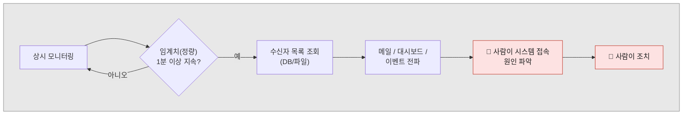
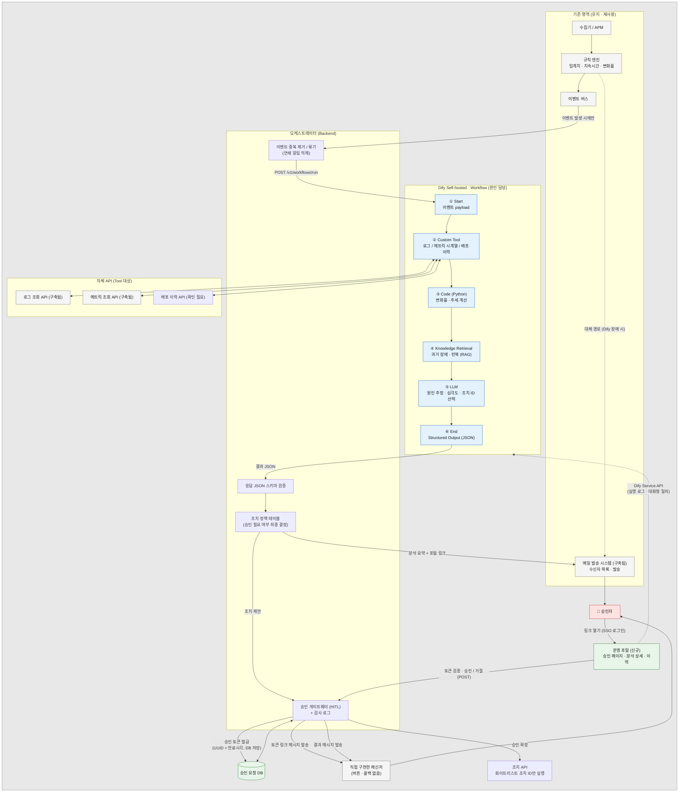
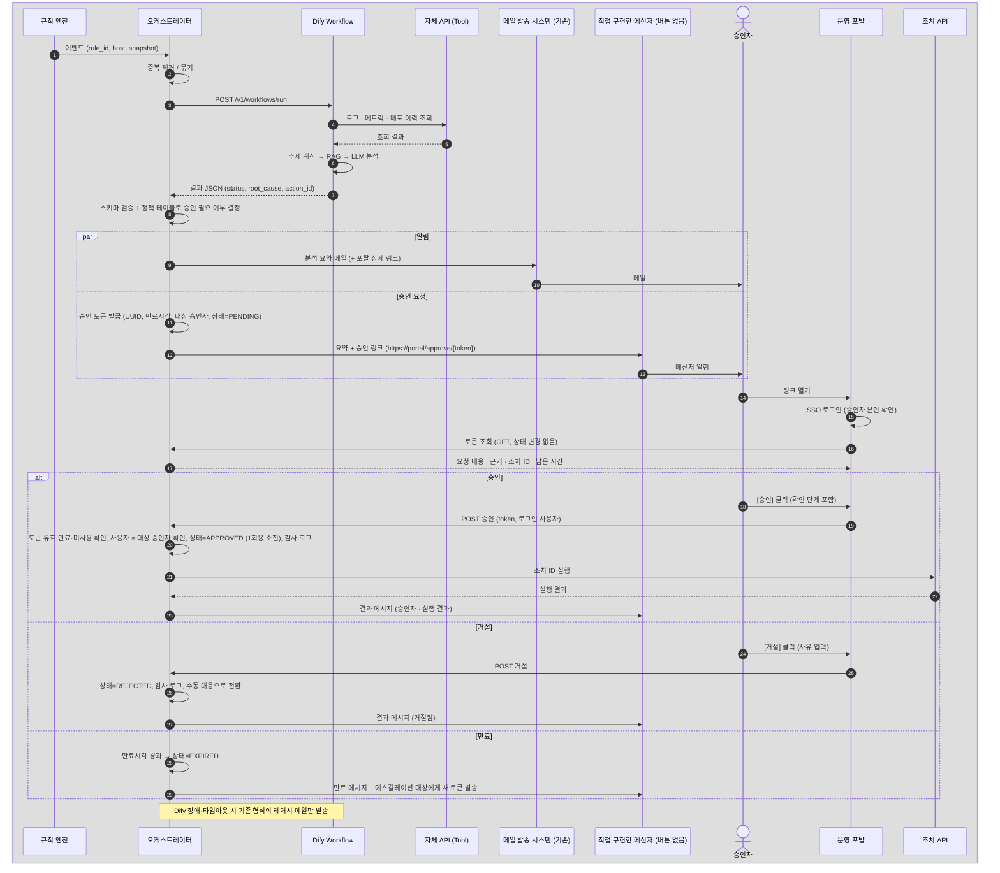
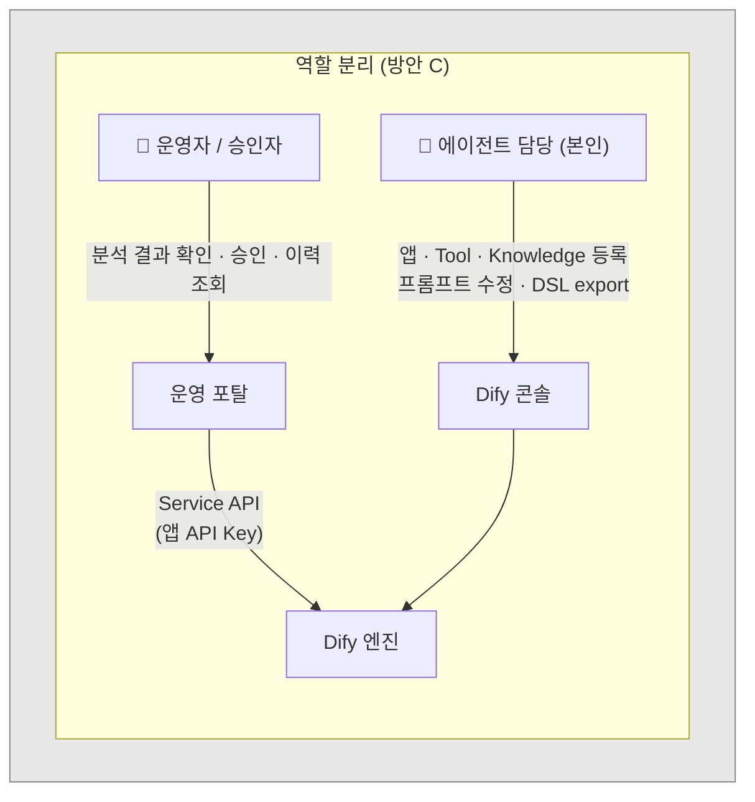
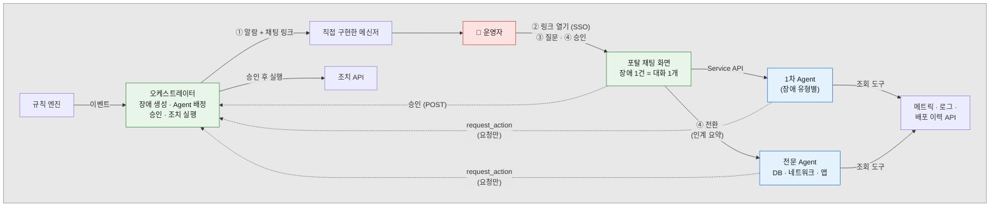
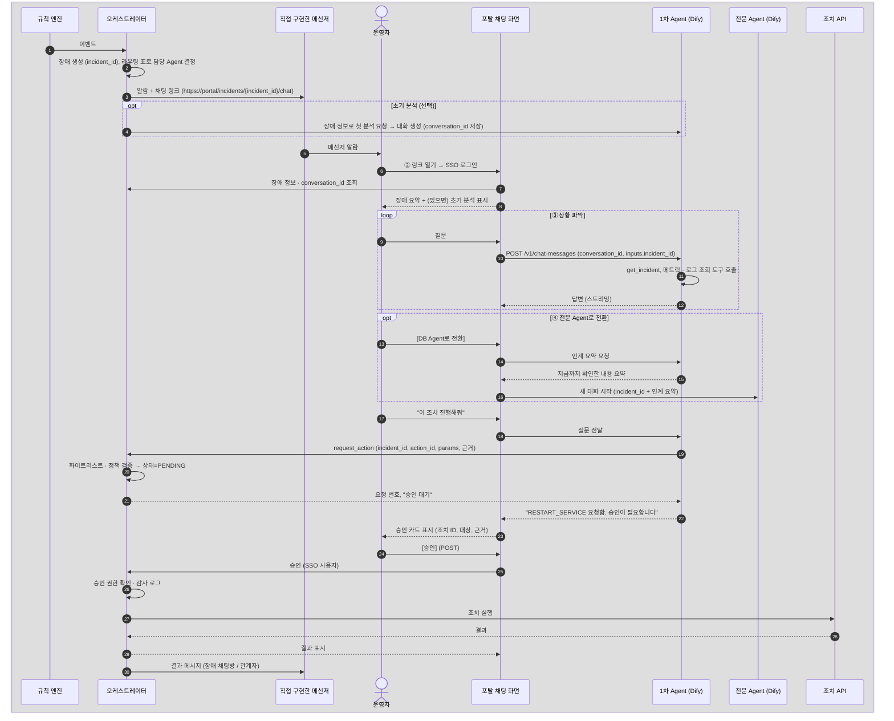
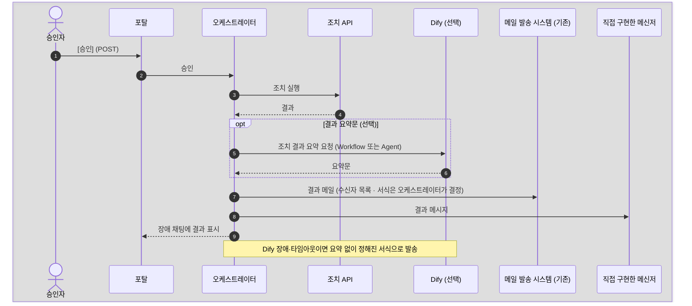

# AI 모니터링 에이전트 아키텍처

> 상태: 초안 (2026-10-21)
> 출발 문서: [claude_code_prompt_specification.md](claude_code_prompt_specification.md) (Gemini 작성본)
> 관련 문서: [02_dify_agent_prerequisites.md](02_dify_agent_prerequisites.md) · [03_dify_agent_registration_guide.md](03_dify_agent_registration_guide.md)

---

## 1. 레거시 방식과 AI 에이전트 방식의 차이

### 1.1 레거시 흐름



이 흐름에서 시스템이 하는 일은 **"알린다"** 까지다. 무슨 일이 일어났고, 왜 일어났고, 무엇을 해야 하는지는 메일을 받은 사람이 직접 알아내야 한다.

### 1.2 AI 에이전트가 들어오면 바뀌는 지점

에이전트가 레거시 파이프라인을 대체하지는 않는다. **감지는 그대로 두고, 그 다음 단계를 맡는다.** 사람이 메일을 받고 나서 하던 일, 즉 접속하고, 로그를 보고, 원인을 추정하고, 조치 방법을 고르는 일을 에이전트가 먼저 해 둔다.

| 단계 | 레거시 | AI 에이전트 도입 후 |
|---|---|---|
| 감지 | 고정 임계치 (CPU > 90%, 1분 지속) | 고정 임계치는 **유지**하고, 추세·변화율·로그 패턴 같은 정성 신호를 추가 |
| 판단 | 없음 (넘었다/안 넘었다) | 맥락 해석: 배포 직후인지, 배치 시간대인지, 다른 지표와 함께 움직이는지 |
| 원인 분석 | 사람이 접속해서 로그를 확인 | 에이전트가 관련 로그·메트릭·최근 변경 이력을 직접 조회하고 원인을 요약 |
| 알림 대상 | 고정 목록 (DB/파일) | 목록은 유지하고, 심각도와 원인 영역에 따라 대상·채널을 고름 |
| 알림 내용 | "CPU 92% 초과" | "CPU 92%. 10:40 배포 후 GC가 급증했고 OOM 로그 3건이 있음. 추정 원인은 X. 권장 조치는 Y." |
| 조치 | 사람이 직접 수행 | 에이전트가 조치를 제안하고 사람이 승인하면 실행. 위험도가 낮은 조치는 자동 실행 |
| 사후 | 사람이 장애 보고서 작성 | 타임라인과 조치 이력을 바탕으로 보고서 초안 자동 작성 |
| 학습 | 임계치를 수동으로 튜닝 | 과거 장애·조치 이력을 지식베이스(RAG)에 쌓아 다음 판단에 활용 |

정리하면, **알림을 보내는 시스템**이 **1차 대응까지 하고 사람에게 넘기는 시스템**으로 바뀐다. 사람이 하는 일은 "원인 찾기"에서 "에이전트의 판단을 검토하고 승인하기"로 옮겨간다.

### 1.3 바뀌지 않아야 하는 것 (설계 원칙)

1. **정량 임계치 판정은 코드가 한다.** "CPU > 90%가 1분 지속"은 결정론적 규칙이므로 LLM에 맡기면 안 된다. LLM은 숫자 비교를 틀릴 수 있고 비용도 든다. Gemini 원문 §2.A의 Analysis Rule 1을 프롬프트에 넣는 방식은 수정이 필요하다.
2. **LLM은 매 주기마다 호출하지 않는다.** 원문은 Cron이 돌 때마다 Dify를 호출하는 구조인데, 그러면 정상 상태에서도 토큰을 계속 쓴다. 규칙 엔진이 이벤트(임계치 초과 또는 추세 경고)를 만들었을 때만 에이전트를 호출한다.
3. **에이전트는 자유 형식 명령을 실행하지 않는다.** `recommended_action`에는 셸 명령 문자열이 아니라 **사전에 등록된 조치 ID**(예: `RESTART_SERVICE`, `CLEAR_CACHE`)만 허용한다.
4. **기존 알림 경로는 대체 경로로 남겨 둔다.** Dify나 LLM이 장애일 때도 레거시 알림은 나가야 한다.

---

## 2. 목표 아키텍처



### 2.0 이벤트 1건의 처리 순서



### 2.1 구성요소별 책임

| 구성요소 | 책임 | 담당 |
|---|---|---|
| 수집기 / APM | 메트릭·로그 수집. **조회 API 구축됨** | 기존 |
| 규칙 엔진 | 정량 임계치, 지속시간, 변화율 기반 1차 감지. 이벤트 생성 | Backend |
| 오케스트레이터 | 이벤트를 받아 Dify 호출, 결과 검증, 라우팅, 승인 처리 | Backend |
| **Dify Workflow / Agent** | 맥락 수집(Tool), 분석, 원인 요약, 조치 제안 | **본인 (Dify 등록)** |
| 메일 발송 시스템 | 수신자 목록 관리, 발송 (**구축됨, 재사용**). 본문에 분석 요약과 포탈 링크 추가 | 기존 |
| 승인 게이트웨이 | 승인 토큰 발급·검증·소진, 만료 처리, 승인자 권한 확인, 감사 로그, 메신저 메시지 발송 | Backend |
| 직접 구현한 메신저 | **승인 요청 전달 채널**. 버튼과 콜백이 없어서 토큰 링크가 담긴 메시지만 보냄 | 기존 |
| 운영 포탈 | **승인 페이지**(토큰 링크로 진입, SSO 로그인 후 승인/거절), 분석 근거 상세, 이력, 대시보드 | 신규 |
| 조치 API | 화이트리스트 조치만 실행 | 인프라 / Backend |

### 2.2 Dify 앱 형태 선택

| 형태 | 적합한 경우 | 이 프로젝트에서 |
|---|---|---|
| Workflow | 입력과 출력이 정해진 단발 처리. 단계가 고정 | **기본 분석 파이프라인** (이벤트 1건 → 분석 결과 1건) |
| Agent (Chatflow + Agent 노드) | 상황에 따라 어떤 도구를 부를지 LLM이 결정 | 원인이 불명확할 때 도구를 반복 호출하는 심층 분석, 운영자 대화형 질의 |

~~1차 범위는 Workflow로 시작하고, 대화형 기능은 2차에서 추가한다.~~ → **변경 (2026-10-21)**: 적용 1단계를 "알람 → Agent 채팅으로 상황 파악과 해결"로 정했다 (§2.4). 대화형 Agent가 1단계의 중심이 되고, Workflow 분석은 알람 시점에 미리 돌리는 **초기 분석**(선택)으로 쓴다.

### 2.3 플랫폼 구성 방안

검토 대상은 세 가지다.

| 방안 | 내용 | 장점 | 단점 |
|---|---|---|---|
| **A. Dify Self-hosted** | Dify를 자체 서버에 설치하고 Dify 콘솔에서 에이전트를 등록·운영 | 바로 시작 가능. Workflow·Tool·RAG·로그가 기본 제공됨 | 승인 화면이나 장애 이력 같은 운영 기능은 Dify에 없음 |
| **B. Dify와 비슷한 플랫폼 자체 개발** | LangGraph 같은 프레임워크로 워크플로·도구·RAG 엔진을 직접 구현 | 완전히 통제 가능. 라이선스 제약 없음 | 개발·유지보수 비용이 큼. Dify가 이미 제공하는 기능을 다시 만드는 셈 |
| **C. A + Dify API 기반 별도 포탈** | 엔진은 Dify Self-hosted. 운영자용 화면은 Dify Service API를 호출하는 자체 포탈로 구성 | 엔진은 그대로 쓰고, 운영 기능(승인·이력·대시보드)만 직접 만듦 | 포탈 개발이 필요함 |



**권장: 방안 C (A로 시작해서 포탈을 붙임)**

- 에이전트 등록과 수정은 Dify 콘솔에서 한다. 운영자는 Dify 콘솔에 접근하지 않고 포탈만 사용한다.
- 포탈은 **공식 Service API**(`/v1/workflows/run`, `/v1/chat-messages`, `/v1/workflows/logs` 등, 앱별 API Key)만 사용한다. Dify 콘솔 내부 API(`/console/api/...`)로 앱을 생성하거나 수정하는 기능은 공식 계약이 아니어서 Dify를 업그레이드하면 깨질 수 있으므로 포탈 범위에서 제외한다.
- 승인 상태, 장애 이력, 감사 로그는 Dify가 아니라 **오케스트레이터와 포탈의 DB**에 저장한다. 나중에 엔진을 B안으로 바꾸더라도 포탈과 데이터는 그대로 쓸 수 있다. 다만 Dify 1.13부터는 Human Input 노드로 Dify 안에서 승인 대기를 처리할 수 있어서 이 부분을 재검토하고 있다 ([02 열린 결정](02_dify_agent_prerequisites.md), [03 §5.7](03_dify_agent_registration_guide.md)).
- B안은 Dify 라이선스나 기능 제약 때문에 막힐 때만 검토한다. 이를 위해 오케스트레이터가 엔진을 호출하는 인터페이스(§3 데이터 계약)를 Dify에 종속되지 않게 유지한다.

> **라이선스 확인 필요**: Dify는 Apache 2.0을 기반으로 추가 조건을 붙인 자체 라이선스를 쓴다. 알려진 조건은 (1) 멀티테넌트 SaaS로 운영할 때 상용 라이선스 필요, (2) Dify 콘솔 프론트엔드의 로고·저작권 표시 제거 금지다. 단일 조직용 설치와 Service API를 호출하는 자체 포탈은 문제없을 것으로 보이지만, 사용하는 버전의 LICENSE 파일을 법무와 함께 확인한다.

### 2.4 적용 1단계 시나리오: 알람 → Agent 채팅으로 대응

2026-10-21 결정. 운영자가 알람을 받으면 **해당 장애를 맡은 Agent의 채팅으로 바로 들어가서** 상황을 파악하고 해결한다.

| 단계 | 운영자가 하는 일 | 시스템이 하는 일 |
|---|---|---|
| ① 알람 | 메신저에서 알람을 받는다 | 규칙 엔진 이벤트 → 오케스트레이터가 장애(incident)를 만들고, 담당 Agent를 정해 **채팅 링크**가 담긴 메시지를 보낸다 |
| ② Agent로 이동 | 링크를 연다 | 해당 장애의 Agent 채팅 화면이 열린다. 장애 정보는 이미 Agent에게 전달되어 있다 |
| ③ 상황 파악 | "지금 어떤 상태야?", "언제부터야?", "최근 배포 있었어?" 등을 묻는다 | Agent가 조회 도구(메트릭, 로그, 배포 이력, 과거 장애)를 써서 답한다 |
| ④ 문제 해결 | 해결 방법을 묻고 조치를 결정한다. 필요하면 **연결된 전문 Agent**(DB, 네트워크 등)로 넘어간다 | Agent는 화이트리스트 조치를 **요청**만 한다. 실행은 사람이 승인한 뒤 오케스트레이터가 한다 |



#### 2.4.1 처리 순서



#### 2.4.2 설계 포인트

**1. 알람은 LLM을 기다리지 않는다.** 이벤트가 오면 알람과 채팅 링크를 먼저 보낸다. 초기 분석은 동시에 돌려서, 운영자가 링크를 열었을 때 첫 메시지로 보이게 한다. Dify가 느리거나 장애여도 알람은 기존 속도로 나간다.

**2. 링크로 무엇을 열 것인가**

| 방안 | 링크 대상 | 장점 | 문제 |
|---|---|---|---|
| W. Dify Web App 직접 | `https://dify/chat/{token}?incident_id=...` | 화면 개발이 없다 | **Self-hosted Community Edition의 Web App은 URL을 아는 누구나 로그인 없이 열 수 있다** (접근 제어는 Enterprise 기능). 사용자를 알 수 없어서 채팅 안에서 승인할 수 없고, 누가 무엇을 물었는지 감사 기록이 남지 않는다 |
| **P. 포탈 채팅 화면 (권장)** | `https://portal/incidents/{incident_id}/chat` | SSO로 사용자를 확인한다. 장애 정보, 대화, 승인 카드, 조치 결과를 한 화면에 둔다. Dify 장애 시에도 장애 정보와 대체 안내를 보여줄 수 있다 | 채팅 화면을 만들어야 한다 (Service API 스트리밍 응답 처리) |

W는 PoC 시연용으로만 쓰고, 이때는 **조회 도구만 연결**하고 내부망에서만 접근하게 한다. 운영은 P로 한다 (§2.3 방안 C와 같은 방향).

**3. 장애 정보는 `incident_id`만 넘긴다.** Agent는 `get_incident(incident_id)` 도구로 장애 정보(규칙, 대상, 시각, 스냅샷)를 조회한다. URL에 상세 내용을 넣지 않으므로 링크가 유출되어도 정보가 새지 않고, 1차 Agent와 전문 Agent가 같은 정보를 본다.

**4. 장애 1건 = 대화 1개.** 오케스트레이터가 `incident_id ↔ conversation_id`를 저장한다. Dify 대화는 Service API의 `user` 값에 묶이므로 `user=incident-<incident_id>`로 고정해서 여러 운영자가 같은 대화를 이어 본다. 실제로 누가 말했는지는 포탈이 SSO 사용자로 따로 기록한다.

**5. 연결된 Agent(전문 Agent)로 넘기는 방법**
- 오케스트레이터의 **라우팅 표**: `rule_id` / 서비스 → 1차 Agent, 전환 가능한 전문 Agent 목록
- 1단계: 포탈의 [전환] 버튼. 1차 Agent가 인계 요약을 만들고, 포탈이 전문 Agent와 새 대화를 시작해서 `incident_id`와 요약을 넘긴다. 운영자가 전환 시점을 직접 본다.
- 2단계 이후: Agent가 다른 Agent를 직접 부르는 구조(Workflow 노드로 Agent 연결, [06 §10](06_dify_agent_configuration.md))를 검토한다.

**6. 채팅으로 해결하더라도 실행은 승인 뒤에만 한다.** §1.3 원칙 3과 §3.3 승인 규칙을 그대로 따른다.
- Agent에 연결하는 조치 도구는 `request_action` 하나뿐이다. 오케스트레이터에 **승인 대기 요청을 만들 뿐 실행하지 않는다.** 조치 API 자체는 Agent에 연결하지 않는다.
- 승인은 포탈 채팅 화면의 승인 카드에서 **SSO 사용자가 POST로** 한다. LLM 답변에 "승인했습니다"라고 써도 아무 일도 일어나지 않는다.
- 운영자에게 승인 권한이 없으면 §3.3 방식으로 승인자에게 토큰 링크를 보낸다.
- 실행 결과는 Agent가 `get_action_status`로 조회해 대화에 이어서 설명한다.

**7. 메일·메신저 발송은 Agent 도구로 주지 않는다.** 알람, 승인 요청, 조치 결과, 에스컬레이션은 오케스트레이터가 정해진 수신자 목록과 서식으로 보낸다. Agent가 직접 보내면 수신자를 잘못 고르거나 같은 메일을 반복해서 보내거나 내부 정보가 밖으로 나갈 수 있다. 채팅에서 "관계자에게 공유해줘"가 필요해지면 `request_action`처럼 **요청만 하는 도구**(`request_notification`: 장애 ID와 공유할 요약만 받고, 수신자와 발송은 오케스트레이터가 결정)를 추가한다.

**7-1. 승인 뒤 결과 발송 흐름.** 승인은 포탈에서 일어나므로 Dify는 승인 시점을 모른다. 승인 처리를 받은 오케스트레이터가 이어서 실행하고 발송한다.



- **보내는 주체는 항상 오케스트레이터**다. Dify(LLM)는 필요하면 요약 **문장만** 만든다. 누구에게 보낼지, 보낼지 말지는 코드가 정한다.
- Dify Workflow 안에서 HTTP Request 노드로 메일 API를 부르게 만들 수도 있지만 권장하지 않는다. Dify가 멈추면 결과 메일도 멈추고, 발송 이력이 오케스트레이터와 Dify 두 곳으로 나뉜다.

**8. Swagger API만으로 충분하다 (1단계).** 도구는 모두 OpenAPI 스키마로 등록하는 Custom Tool이다. MCP는 여러 AI 도구가 같은 도구를 쓰게 될 때 검토한다. 도구가 잘 쓰이는지는 API 자체보다 **도구 설명, 응답 크기, 도구 개수**에 달려 있다.
- 설명: `summary`와 `description`에 "언제 쓰는지"를 쓴다. 예: "장애 감지 시각 전후의 지표를 볼 때 사용. 최대 2시간"
- 응답: 필요한 필드만, 짧게. 로그 수천 줄을 그대로 돌려주지 않는다
- 개수: Agent 하나에 도구를 너무 많이 주면 잘못 고른다. 1차 Agent와 전문 Agent에 필요한 것만 나눠서 준다
- 확인: 과거 장애 샘플로 "맞는 도구를 맞는 순서로 불렀는지"를 시험한다 ([02 G](02_dify_agent_prerequisites.md))

**9. Agent를 쓸 수 있는 사람 = 그 Agent의 도구 키 권한을 가진 사람.** Custom Tool은 등록할 때 넣은 서비스 키 하나로 호출하고, Dify는 채팅하는 사용자의 신원을 도구 API에 넘기지 않는다. 그래서 사용자 A에게 API a-2 권한이 없어도, a-1·a-2 권한을 가진 키가 붙은 Agent를 A가 쓸 수 있으면 **A는 Agent를 통해 a-2를 쓸 수 있다** (권한 우회).

| 대책 | 방법 | 효과 |
|---|---|---|
| 키 권한을 Agent 용도에 맞춤 | a-1만 쓰는 Agent에는 **a-1만 허용된 키**를 발급하고, 스키마에도 a-1만 넣어 별도 도구로 등록 | API 쪽에서 막히므로 가장 확실함 |
| Agent에 필요한 작업만 선택 | Agent 도구 추가 시 공급자 전체(`/*`)가 아니라 a-1 작업만 선택 | Agent가 a-2를 부르지 않음. 다만 키에는 권한이 남아 있으므로 보조 수단 |
| Agent 사용 권한 관리 | 포탈 채팅 화면에서 SSO 사용자의 역할로 쓸 수 있는 Agent를 제한. Web App 직접 링크는 누구나 열 수 있으므로 쓰지 않음 (§2.4.2 2) | 권한이 다른 사람은 다른 Agent를 쓰게 함 |
| 조치는 승인 시점에 다시 확인 | 실행 계열은 `request_action`으로 요청만 하고, 승인 페이지에서 **SSO 사용자의 승인 권한**을 확인 | Agent로 요청이 들어와도 권한 없는 실행은 막힘 |

- **Dify는 Agent를 만드는 사람의 권한으로 도구를 제한하지 않는다.** Custom Tool을 등록·수정·삭제하는 것은 워크스페이스 owner·admin만 할 수 있지만, 등록된 도구를 Agent에 붙이는 것은 앱을 만들 수 있는 멤버 누구나 할 수 있다 (1.17.1 `controllers/console/workspace/tool_providers.py`). 그래서 "Agent 만들 때 쓸 수 있는 도구를 한정"하려면 다음처럼 한다.
  - **권한 그룹별로 워크스페이스를 나눈다.** 도구와 키는 워크스페이스 단위로 등록되므로, a-2 권한 키가 있는 도구는 a-2 권한 그룹의 워크스페이스에만 둔다.
  - 한 워크스페이스를 같이 쓴다면, 그 안의 도구 키는 **그 워크스페이스 멤버 모두가 써도 되는 권한까지만** 준다.
  - Agent 게시는 리뷰를 거친다. 어떤 도구가 붙었는지 DSL로 확인한다 ([03 §8](03_dify_agent_registration_guide.md)).
- 사용자 ID를 도구 파라미터로 받아 API가 권한을 검사하는 방식은 쓰지 않는다. 그 값은 LLM이 채우는 것이라 바뀔 수 있다.
- 원칙: **권한 그룹마다 Agent와 키를 나눈다.** 조회는 키 범위로, 실행은 승인 단계의 사용자 권한으로 통제한다.

**Agent에 연결할 도구 (1단계)**

| 도구 | 용도 | 비고 |
|---|---|---|
| `get_incident` | 장애 정보 조회 | 오케스트레이터 API |
| `query_metrics`, `search_logs` | 메트릭, 로그 조회 | 기존 API (구축됨) |
| `get_deployments` | 배포 이력 조회 | 존재 여부 확인 필요 |
| Knowledge | 과거 장애, 런북 | RAG |
| `request_action` | 화이트리스트 조치 **요청** | 오케스트레이터 API. 실행 아님 |
| `get_action_status` | 요청한 조치의 상태와 결과 | 오케스트레이터 API |

---

## 3. 데이터 계약 (초안)

### 3.1 오케스트레이터 → Dify (Workflow inputs)

```json
{
  "event_id": "evt-20261021-0001",
  "source_system": "order-api",
  "host": "prd-app-03",
  "rule_id": "CPU_HIGH_1M",
  "detected_at": "2026-10-21T10:41:00+09:00",
  "metric_snapshot": "{\"cpu\": 92.4, \"mem\": 71.0, \"tps\": 1830}",
  "window_minutes": 15
}
```

> Dify Workflow 입력 변수는 문자열·숫자 위주이므로 중첩 객체는 JSON 문자열로 넘기고 Code 노드에서 파싱한다. (확인 필요: 사용하는 Dify 버전에서 object 타입 입력을 지원하는지)

### 3.2 Dify → 오케스트레이터 (출력)

```json
{
  "status": "NORMAL | WARNING | CRITICAL",
  "trend_analysis": "string",
  "root_cause_summary": "string (2~3문장)",
  "evidence": ["근거로 삼은 로그/지표 요약"],
  "recommended_action_id": "RESTART_SERVICE | CLEAR_CACHE | SCALE_OUT | NONE",
  "action_params": { "service": "order-api" },
  "requires_approval": true,
  "confidence": 0.0
}
```

원문 대비 변경점:
- `recommended_action`(자유 문자열) → `recommended_action_id` + `action_params` (화이트리스트)
- `evidence`, `confidence` 추가: 승인자가 판단 근거를 확인할 수 있게 함
- `requires_approval`은 LLM이 정하지 않고 **조치 ID별 정책 테이블**로 오케스트레이터가 최종 결정한다 (LLM 값은 참고용)

### 3.3 승인 토큰

직접 구현한 메신저는 버튼과 콜백이 없고 링크는 넣을 수 있다. 그래서 **유효기간이 있는 1회용 토큰을 링크로 보내고, 승인은 포탈 승인 페이지에서** 한다.

**메시지 예시**
```
[CRITICAL] order-api / prd-app-03
원인 추정: 10:40 배포 후 힙 사용량 급증, OOM 3건
제안 조치: RESTART_SERVICE (order-api)
승인 링크 (10:56까지 유효): https://portal.internal/approve/3f8c2a1e-7b4d-4e0a-9c55-1d2e6f7a8b90
```

**토큰 테이블 (승인 요청 DB)**

| 컬럼 | 설명 |
|---|---|
| `token_hash` | 토큰의 SHA-256 해시. **원문은 저장하지 않는다** (DB가 유출되어도 링크로 쓸 수 없게) |
| `event_id` / `analysis_id` | 어떤 분석 결과에 대한 승인인지 |
| `action_id`, `action_params` | 승인 대상 조치 (발급 시점에 고정. 승인 페이지에서 바꿀 수 없음) |
| `approver_id` | 대상 승인자 (사번). 승인자가 여러 명이면 사람마다 토큰을 따로 발급 |
| `expires_at` | 만료시각. **서버 DB 값이 기준** |
| `status` | `PENDING` → `APPROVED` / `REJECTED` / `EXPIRED` / `SUPERSEDED` |
| `decided_by`, `decided_at`, `reason` | 실제 결정한 사람(SSO 사용자), 시각, 거절 사유 |

**규칙**
1. **토큰 생성**: 암호학적으로 안전한 난수로 UUID v4를 생성한다 (`uuid.uuid4()`, `crypto.randomUUID()` 등). 순번이나 시간 기반 UUID(v1)는 추측할 수 있으므로 쓰지 않는다.
2. **유효기간은 서버에서 관리**한다. 만료시각을 토큰 문자열 안에 넣는다면 HMAC 서명을 붙여야 한다. 서명이 없으면 사용자가 값을 고쳐서 기한을 늘릴 수 있다. 가장 간단한 방법은 토큰에는 UUID만 넣고 만료시각은 DB에 두는 것이다.
3. **링크를 여는 것(GET)만으로는 아무것도 바뀌지 않는다.** 승인과 거절은 페이지 안의 버튼(POST)으로만 한다. 메신저의 링크 미리보기 기능이나 보안 스캐너가 링크를 먼저 열어 볼 수 있기 때문이다.
4. **토큰만으로 승인되지 않는다.** 승인 페이지는 SSO 로그인을 요구하고, 로그인한 사용자가 `approver_id`와 같거나 승인 권한이 있는지 확인한다. 링크가 다른 사람에게 전달되거나 채팅방에 노출되어도 대신 승인할 수 없게 하기 위해서다.
5. **1회용**: 결정이 나면 즉시 상태를 바꾸고(조건부 UPDATE `WHERE status='PENDING'`), 같은 이벤트에 대한 다른 승인자의 토큰은 `SUPERSEDED`로 바꾼다. 결정은 먼저 한 사람 것 하나만 유효하다.
6. **유효기간**: 조치 위험도와 장애 심각도에 따라 정한다 (예: CRITICAL 15분, WARNING 60분). 만료되면 에스컬레이션 대상에게 새 토큰을 발급한다.
7. **감사 로그**: 발급, 조회, 결정, 만료를 모두 기록한다 (토큰 원문은 기록하지 않음).

---

## 4. 열린 질문

- [x] ~~Dify 배포 형태~~ → Self-hosted (또는 자체 플랫폼, Dify API 기반 포탈). §2.3 참고
- [x] ~~로그·메트릭 조회 API 존재 여부~~ → **구축됨**
- [x] ~~레거시 알림~~ → 메일 발송 시스템 **어느 정도 구축됨**, 재사용
- [ ] Dify 버전 (설치 예정 버전 / 기존 설치본)
- [ ] 방안 A / B / C 최종 결정
- [ ] 사용할 LLM 모델과 외부 반출 가능 데이터 범위 (자체 호스팅 모델인지, 외부 API인지, 로그 마스킹 필요 여부)
- [ ] 기존 로그·메트릭 API의 스펙 문서 형태 (OpenAPI 유무), 인증 방식, 응답 크기 제한
- [ ] 기존 메일 시스템을 외부에서 호출할 수 있는지 (API / 큐 / DB insert), 본문 템플릿(HTML)을 바꿀 수 있는지
- [x] ~~메일 외 채널~~ → **승인은 직접 구현한 메신저**로 함 (2026-10-21)
- [x] ~~메신저 기능~~ → 직접 구현한 메신저. **버튼·콜백 없음, 링크는 가능**. 유효기간 + UUID 토큰 링크 발송 방식 (§3.3)
- [ ] 포탈 승인 페이지에 SSO를 적용할 수 있는지
- [x] ~~메시지에 링크를 넣을 수 있는지~~ → **가능**
- [ ] 메신저가 링크 미리보기(URL 사전 접속)를 하는지. 해도 문제는 없지만(§3.3 규칙 3) 접속 로그를 해석할 때 필요
- [ ] 배포 이력 API 존재 여부
- [ ] 규칙 엔진을 기존 모니터링 솔루션이 담당하는지, 새로 구현하는지
- [ ] 자동 실행을 허용할 조치 범위
- [x] ~~적용 1단계 범위~~ → 알람 → Agent 채팅으로 상황 파악 → 채팅(또는 전문 Agent 채팅)으로 해결 (§2.4)
- [ ] 채팅 링크 대상: Dify Web App 직접(W) / 포탈 채팅 화면(P) (§2.4.2)
- [ ] 장애 유형별 1차 Agent와 전문 Agent 목록, 라우팅 기준(rule_id, 서비스)
- [ ] 초기 분석을 알람 시점에 미리 돌릴지

---

## 변경 이력

| 날짜 | 내용 |
|---|---|
| 2026-10-21 | 초안 작성. 레거시 비교, 목표 아키텍처, 데이터 계약 초안 |
| 2026-10-21 | 아키텍처 다이어그램을 Mermaid로 전환 (레거시 흐름, 목표 아키텍처, 처리 시퀀스) |
| 2026-10-21 | Self-hosted 전제 반영. §2.3 플랫폼 구성 방안(A/B/C) 추가. 기존 로그·메트릭 API와 메일 시스템 재사용, 운영 포탈 추가 |
| 2026-10-21 | Human Input 노드(Dify 1.13+)를 승인 처리 대안으로 언급 |
| 2026-10-21 | 승인 채널을 직접 구현한 메신저로 확정. 다이어그램·시퀀스·책임표 반영 |
| 2026-10-21 | 메신저 버튼·콜백 없음 → 토큰 링크 + 포탈 승인 페이지 구조로 변경. §3.3 승인 토큰 추가 |
| 2026-10-21 | 적용 1단계 시나리오(알람 → Agent 채팅 → 상황 파악 → 해결) §2.4 추가. 대화형 Agent를 1단계로 앞당김. Web App 직접 연결 대신 포탈 채팅 화면 권장 |
| 2026-10-22 | §2.4.2에 메일·메신저 발송 주체(오케스트레이터), 승인 뒤 결과 발송 흐름(7-1), Swagger API 도구 품질 기준(8) 추가 |
| 2026-10-22 | §2.4.2-9 도구 키를 통한 권한 우회와 대책(권한 그룹별 Agent·키 분리, 승인 시점 권한 확인) 추가 |
