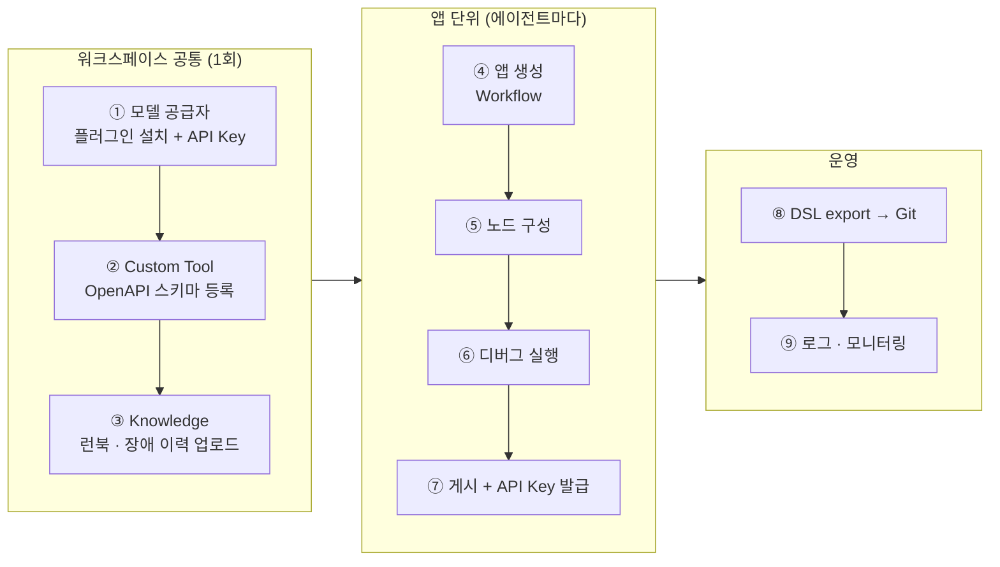
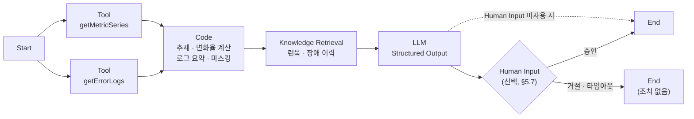

# Dify 에이전트 등록 절차

> 상태: 초안 (2026-10-21) · 기준: Dify Community Edition 1.15.x (Self-hosted)
> 상위 문서: [01_architecture.md](01_architecture.md) · 사전 준비: [02_dify_agent_prerequisites.md](02_dify_agent_prerequisites.md) · 구조: [04_dify_platform_structure.md](04_dify_platform_structure.md)
> 메뉴 이름은 버전에 따라 조금씩 다를 수 있다. 실제 설치본에서 확인한 뒤 이 문서를 고친다.

---

## 0. 전체 흐름

등록 순서는 **재료(모델, Tool, Knowledge)를 먼저 워크스페이스에 등록하고 → 앱을 만들어 조립하고 → 게시하고 API를 연결하는 순서**다. 앱 안에서는 워크스페이스에 등록된 것만 고를 수 있다.



---

## 1. 모델 공급자 등록 (워크스페이스 공통)

Dify 1.0부터 모델 공급자는 **플러그인**으로 설치한다.

1. 우측 상단 프로필 → **Settings → Model Provider**
2. 사용할 공급자(OpenAI, Anthropic, Azure OpenAI, Ollama, OpenAI-API-compatible 등)의 플러그인을 Marketplace에서 설치
   - 폐쇄망이라면 `.difypkg` 파일을 받아 **Plugins → Install from Local Package**로 설치
   - 자체 LLM 서버(vLLM 등)는 보통 **OpenAI-API-compatible** 플러그인으로 연결
3. API Key 또는 엔드포인트 입력 후 저장
4. **System Model Settings**에서 기본 모델 지정
   - 기본 추론 모델 (LLM)
   - Embedding 모델 (Knowledge 고품질 인덱싱에 필요)
   - Rerank 모델 (선택. 검색 품질 향상)

확인: 앱의 LLM 노드에서 모델 목록에 나타나면 완료.

---

## 2. Custom Tool 등록 (기존 로그·메트릭 API)

에이전트가 로그와 메트릭을 직접 조회하려면 기존 API를 Tool로 등록해야 한다.

1. 상단 **Tools → Custom → Create Custom Tool**
2. 이름, 아이콘 입력
3. **Schema**: OpenAPI 3.0 스펙을 붙여넣거나, URL에서 가져오기(Import from URL)
4. **Authentication**: None / API Key 중 선택
   - API Key: Header(Bearer, Basic, Custom 헤더명) 또는 Query 파라미터
   - 읽기 전용 키를 사용한다 ([02 §C](02_dify_agent_prerequisites.md))
5. 스키마를 파싱해서 생성된 Tool 목록을 확인하고 **Test**로 실제 호출 확인
6. 저장. 인증 정보는 워크스페이스 전체에 적용된다.

### 2.1 OpenAPI 스키마 예시 (기존 API에 맞게 수정)

```yaml
openapi: 3.0.1
info:
  title: Monitoring Query API
  version: "1.0"
servers:
  - url: https://monitoring-api.internal
paths:
  /api/logs/errors:
    get:
      operationId: getErrorLogs
      summary: 특정 호스트·서비스의 에러 로그 조회
      description: 지정 시간 범위의 ERROR/FATAL 로그를 최신순으로 반환한다.
      parameters:
        - { name: host,    in: query, required: true,  schema: { type: string } }
        - { name: service, in: query, required: false, schema: { type: string } }
        - { name: from,    in: query, required: true,  schema: { type: string, format: date-time } }
        - { name: to,      in: query, required: true,  schema: { type: string, format: date-time } }
        - { name: limit,   in: query, required: false, schema: { type: integer, default: 100 } }
      responses:
        "200":
          description: OK
          content:
            application/json:
              schema:
                type: object
                properties:
                  items:
                    type: array
                    items:
                      type: object
                      properties:
                        ts:      { type: string }
                        level:   { type: string }
                        message: { type: string }
  /api/metrics/series:
    get:
      operationId: getMetricSeries
      summary: 지표 시계열 조회
      parameters:
        - { name: host,   in: query, required: true, schema: { type: string } }
        - { name: metric, in: query, required: true, schema: { type: string, enum: [cpu, mem, tps, gc] } }
        - { name: from,   in: query, required: true, schema: { type: string, format: date-time } }
        - { name: to,     in: query, required: true, schema: { type: string, format: date-time } }
        - { name: step,   in: query, required: false, schema: { type: string, default: "1m" } }
      responses:
        "200": { description: OK }
```

작성 팁:
- `operationId`가 Tool 이름이 되고, `summary`와 `description`은 LLM이 어떤 Tool을 고를지 판단하는 근거가 된다. 명확하게 쓴다.
- `limit` 같은 파라미터로 **응답 크기를 제한**한다. 로그 수천 줄을 그대로 넘기면 LLM 컨텍스트가 넘친다.
- Workflow에서 호출 순서가 고정되어 있다면 Custom Tool 대신 **HTTP Request 노드**로 직접 호출해도 된다. Tool 등록은 Agent 노드가 Tool을 스스로 골라 써야 할 때 특히 필요하다.

---

## 3. Knowledge 생성 (런북·장애 이력)

1. 상단 **Knowledge → Create Knowledge**
2. 데이터 소스 선택: 파일 업로드(PDF, DOCX, MD, TXT 등) / Notion / 웹 사이트
3. **청크 설정**
   - 런북은 장애 유형별 절 단위로 나뉘도록 구분자(예: `##`)와 최대 길이를 지정
   - 장애 보고서는 1건 = 1문서 또는 Parent-child 청크 모드
4. **인덱싱 방식**: High Quality (Embedding 모델 사용)
5. **검색 설정**: Hybrid Search + Rerank 권장. Top K와 Score 임계값 설정
6. 저장 후 **Retrieval Testing**으로 실제 질의를 넣어 원하는 문서가 나오는지 확인
   - 예: "OOM 발생 후 GC 급증" → JVM 메모리 런북이 나와야 함

---

## 4. 앱 생성

1. 상단 **Studio → Create from Blank**
2. 앱 유형 선택

| 유형 | 용도 |
|---|---|
| **Workflow** | 1차 범위. 이벤트 1건을 받아 분석 결과 1건을 출력 |
| Chatflow | 2차 범위. 운영자 대화형 질의 (Agent 노드 포함) |
| Agent (기본 앱) | 간단한 Tool 호출형 챗봇. 이 프로젝트에서는 Chatflow + Agent 노드를 권장 |

3. 이름과 설명 입력 (예: `monitoring-incident-analyzer`)
4. 이미 만들어 둔 DSL(YAML)이 있으면 **Import DSL**로 생성

---

## 5. 노드 구성 (Workflow)

[01_architecture.md §2](01_architecture.md) 의 ①~⑥에 해당한다.



### 5.1 Start: 입력 변수

| 변수 | 타입 | 비고 |
|---|---|---|
| `event_id` | Text | |
| `source_system` | Text | |
| `host` | Text | |
| `rule_id` | Text 또는 Select | 규칙 ID 목록이 고정되어 있으면 Select |
| `detected_at` | Text | ISO-8601 |
| `metric_snapshot` | **Paragraph** | JSON 문자열. Text는 기본 최대 길이가 짧으므로 Paragraph 사용 |
| `window_minutes` | Number | |

### 5.2 Tool / HTTP Request: 맥락 수집
- §2에서 등록한 Tool을 추가하고 파라미터에 Start 변수를 연결한다 (`host` ← `{{#start.host#}}`).
- 시간 범위(`from`, `to`)는 앞에 Code 노드를 하나 두고 `detected_at`, `window_minutes`로 계산한다.
- API의 base URL이나 키를 HTTP Request 노드에 직접 넣는 경우 **Environment Variables**(Secret 타입)로 관리한다.

### 5.3 Code: 추세 계산 · 전처리
- Python 3 또는 JavaScript. 샌드박스에서 실행되므로 사용할 수 있는 패키지가 제한된다.
- `main()` 함수가 dict를 반환하고, 출력 변수와 타입을 노드 설정에 선언한다.
- 이 노드가 할 일: 변화율·기울기 계산, 로그 중복 제거와 상위 N개 추출, 호스트명·IP·개인정보 마스킹.

```python
def main(series_json: str, logs_json: str) -> dict:
    import json
    pts = json.loads(series_json)["values"]          # [[ts, v], ...]
    vals = [float(v) for _, v in pts]
    slope = (vals[-1] - vals[0]) / max(len(vals) - 1, 1)
    logs = json.loads(logs_json)["items"]
    uniq = list({l["message"][:200]: l for l in logs}.values())[:20]
    return {
        "trend_slope": round(slope, 3),
        "trend_summary": f"{len(vals)}개 구간, 시작 {vals[0]} → 현재 {vals[-1]}, 기울기 {slope:.2f}/분",
        "log_digest": "\n".join(f'{l["ts"]} {l["level"]} {l["message"][:200]}' for l in uniq),
    }
```

### 5.4 Knowledge Retrieval
- §3에서 만든 Knowledge를 선택한다.
- 질의 변수: `rule_id`와 Code 노드의 로그 요약 앞부분을 조합한 문자열.

### 5.5 LLM: 분석
- 모델 선택, **System 프롬프트**에 역할·규칙·출력 형식을 작성한다 ([02 §E](02_dify_agent_prerequisites.md)에서 확정).
- 정량 임계치 판정은 프롬프트에 넣지 않는다. 판정은 이미 규칙 엔진이 했고, LLM에는 결과만 사실로 전달한다.
- **Structured Output**을 켜고 [01 §3.2](01_architecture.md)의 JSON Schema를 등록한다 (Visual Editor 또는 JSON Schema 직접 입력). 모델이 Structured Output을 지원하는지 확인한다.
- `recommended_action_id`는 JSON Schema의 `enum`으로 화이트리스트를 강제한다.

### 5.6 End: 출력 변수
- LLM 노드의 structured output 필드를 End 노드의 출력 변수로 연결한다.
- 오케스트레이터는 API 응답의 `data.outputs`로 이 값을 받는다.

### 5.7 (선택) Human Input 노드: Dify 안에서 승인 처리

Dify 1.13부터 **Human Input 노드**로 워크플로를 중간에 멈추고 사람의 결정을 기다릴 수 있다. 1.14부터는 Service API로 외부 시스템이 이 승인 폼을 다룰 수 있다.

- **전달 방식**
  - Email: 지정한 수신자에게 링크를 보낸다. Dify 계정이 없어도 응답할 수 있다. Self-hosted에서는 Dify의 메일(SMTP) 설정이 필요하다.
  - Web app: 외부 클라이언트(우리 **운영 포탈**)가 Service API로 폼을 조회하고 제출한다.
- **버튼(Action)**: 승인 / 거절 / 에스컬레이션 같은 버튼을 정의하고, 버튼마다 다른 분기로 이어진다. 다음 노드에서는 `__action_id`로 어떤 버튼이 눌렸는지 받는다.
- **타임아웃**: 기본 3일. 시간이 지나면 타임아웃 분기로 간다. 이 분기를 연결하지 않으면 워크플로가 종료된다.
- **제약**: 첫 응답 한 건으로 폼이 닫힌다.
- **API 흐름** (스트리밍 모드에서만):
  1. `POST /v1/workflows/run`을 `response_mode: streaming`으로 호출
  2. `human_input_required` 이벤트에서 `form_token`, `workflow_run_id`를 받음
  3. 포탈에서 `GET /v1/form/human_input/{form_token}`으로 폼을 조회해 화면에 표시
  4. 승인자가 결정하면 `POST /v1/form/human_input/{form_token}`으로 `action` 제출
  5. 워크플로 이벤트 스트림을 다시 구독해서 이후 결과를 받음

> **이 프로젝트에서는**: 승인을 직접 구현한 메신저에서 하기로 했다. Human Input 노드는 메신저로 직접 보내는 기능이 없으므로, 1차 범위에서는 **Human Input 노드를 쓰지 않고** Workflow가 분석 결과를 출력하고 끝나도록 구성한다. 승인은 오케스트레이터가 직접 구현한 메신저로 토큰 링크를 보내고, 포탈 승인 페이지에서 처리한다 ([01 §3.3](01_architecture.md)). 어느 쪽이든 **실제 조치 실행은 오케스트레이터가 화이트리스트로 검증한 뒤에** 한다.

---

## 6. 디버그 실행

1. 편집 화면 우측 상단 **Run**(테스트 실행)
2. [02 §G](02_dify_agent_prerequisites.md)에서 모은 과거 장애 샘플 payload를 입력
3. **Tracing** 패널에서 노드별 입력·출력, 소요 시간, 토큰 사용량을 확인
4. 확인할 것
   - Tool 호출이 성공하는지, 응답 크기가 적당한지
   - Code 노드 출력 타입이 선언과 맞는지
   - Knowledge Retrieval이 관련 문서를 가져오는지
   - LLM 출력이 스키마를 지키는지, 원인 추정이 실제 원인과 맞는지

---

## 7. 게시 및 API 연결

1. 우측 상단 **Publish**. 게시한 버전만 API로 호출된다. 편집 중인 초안은 호출되지 않는다.
2. 좌측 **API Access** → **API Key** 생성 (앱 단위 키. `app-`로 시작)
3. 키는 오케스트레이터의 Vault 또는 환경변수에 보관한다. 포탈에 키를 직접 넣지 않고 서버 측에서만 사용한다.
4. 호출 예시

```bash
curl -X POST 'https://dify.internal/v1/workflows/run' \
  -H 'Authorization: Bearer app-xxxxxxxx' \
  -H 'Content-Type: application/json' \
  -d '{
    "inputs": {
      "event_id": "evt-20261021-0001",
      "source_system": "order-api",
      "host": "prd-app-03",
      "rule_id": "CPU_HIGH_1M",
      "detected_at": "2026-10-21T10:41:00+09:00",
      "metric_snapshot": "{\"cpu\": 92.4, \"mem\": 71.0}",
      "window_minutes": 15
    },
    "response_mode": "blocking",
    "user": "system:order-api"
  }'
```

- `response_mode`: `blocking`은 끝날 때까지 기다렸다가 결과를 한 번에 받는다. `streaming`은 SSE로 받는다. **Human Input을 쓰면 streaming이 필요하다.**
- `user`: 호출 주체 식별자. Dify 로그에서 필터링할 때 쓴다.
- 결과: `data.outputs`(End 노드 출력), `data.status`, `data.elapsed_time`, `data.total_tokens`
- 실행 로그 조회: `GET /v1/workflows/logs`. 포탈의 이력 화면에서 사용할 수 있다.
- 1.15부터 공식 CLI `difyctl`로 터미널에서 앱 목록 조회와 실행이 가능하다. 테스트 자동화에 활용할 수 있다.

---

## 8. 버전 관리 (DSL)

1. 앱 목록 또는 편집 화면 메뉴 → **Export DSL** (YAML)
2. Secret 환경변수를 포함할지 묻는 단계가 있다. **포함하지 않는다.**
3. 이 저장소의 `dify/apps/<app-name>.yml`로 커밋한다.
4. 다른 환경(개발 → 운영)에는 **Import DSL**로 옮긴 다음 Secret만 다시 입력한다.
5. 프롬프트를 수정할 때도 DSL을 다시 export해서 diff로 리뷰한다.
6. 자동화: 1.15부터 공식 CLI로 import와 export를 할 수 있다. 공식 등록 API는 없으므로 CI/CD는 이 CLI로 구성한다 ([04 §5](04_dify_platform_structure.md)).

```bash
difyctl export studio-app <app-id> > dify/apps/monitoring-incident-analyzer.yml   # 기본은 초안. 게시 버전은 --workflow-id
difyctl import studio-app --from-file dify/apps/monitoring-incident-analyzer.yml  # 새로 생성
difyctl import studio-app --from-file dify/apps/monitoring-incident-analyzer.yml --app-id <app-id>  # 덮어쓰기
```

---

## 9. 운영 · 모니터링

- 앱의 **Logs & Annotations**: 실행별 입력·출력과 노드 추적
- **Monitoring**: 호출 수, 토큰, 응답 시간
- 외부 관측 도구 연동(Langfuse, LangSmith, Opik 등): 앱 설정의 Tracing 또는 Monitoring 메뉴
- Dify 자체가 장애일 때는 레거시 메일만 나가는지 주기적으로 점검한다 ([01 §1.3](01_architecture.md))

---

## 10. (2차) Chatflow + Agent 노드

운영자가 "왜 그렇게 판단했어?", "지난주에도 같은 일이 있었어?"라고 묻는 대화형 기능에 쓴다.

1. **Plugins**에서 Agent Strategy 플러그인 설치 (Function Calling / ReAct)
2. Studio → Create → **Chatflow**
3. **Agent** 노드 추가 → 전략 선택 → 모델 선택 → §2의 Custom Tool 여러 개 연결 → 지시문 작성 → 최대 반복 횟수 제한
4. 조치 실행 Tool은 연결하지 않는다. 조회 Tool만 연결한다.
5. 포탈에서 `POST /v1/chat-messages`로 호출하고 `conversation_id`로 대화를 이어간다.

---

## 참고 자료

- [Human Input 노드 (Self-hosted)](https://docs.dify.ai/en/self-host/use-dify/nodes/human-input.md)
- [Human Input API 흐름](https://docs.dify.ai/en/api-reference/guides/human-input-flow)
- [LLM 노드 / Structured Output](https://docs.dify.ai/en/self-host/use-dify/nodes/llm.md)
- [Custom Tool (Workspace Tools)](https://enterprise-docs.dify.ai/en/3.10.x/use/workspace/tools.md)
- [difyctl 출시 공지](https://dify.ai/blog/dify-s-official-cli-difyctl-ships)

## 변경 이력

| 날짜 | 내용 |
|---|---|
| 2026-10-21 | 초안 작성. 1.15.x 기준 등록 절차, Human Input 노드 반영 |
| 2026-10-21 | 메신저 승인 결정에 따라 1차 범위에서 Human Input 노드 미사용으로 정리 |
| 2026-10-21 | §8에 difyctl import/export 추가 |
