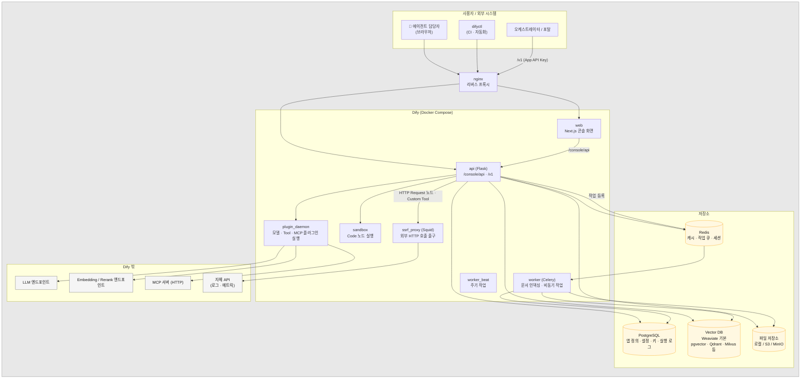
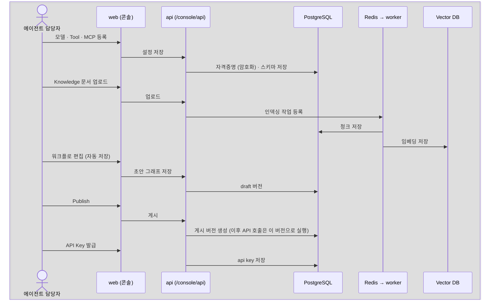
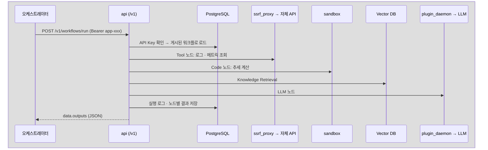

# Dify 플랫폼 구조: 등록 화면 · API · 저장소

> 상태: 초안 (2026-10-21) · 기준: Dify Community Edition 1.15.x (Self-hosted, Docker Compose)
> 목적: 에이전트를 "등록"하고 "호출"할 때 Dify 안에서 무엇이 어디로 흐르고, 어디에 저장되는지를 이해한다.
> 관련: [03 등록 절차](03_dify_agent_registration_guide.md) · [02 사전 준비](02_dify_agent_prerequisites.md)

---

## 1. 한 장 요약

Dify는 크게 **등록하는 길**과 **실행하는 길**이 나뉜다.

| | 등록 (만들기) | 실행 (쓰기) |
|---|---|---|
| 누가 | 에이전트 담당자 | 오케스트레이터, 포탈 |
| 화면 / 도구 | Dify 콘솔 (웹), `difyctl` | 없음 (서버 간 호출) |
| API | Console API `/console/api/...` (**내부용, 공식 계약 아님**) | Service API `/v1/...` (**공식, 문서화됨**) |
| 인증 | 콘솔 로그인 세션 | 앱별 API Key (`app-...`), Knowledge API Key (`dataset-...`) |
| 결과 | PostgreSQL에 앱 정의(워크플로 그래프) 저장 | 게시된 버전을 읽어 실행, 실행 로그 저장 |

---

## 2. 구성요소

| 구성요소 | 역할 | 이 프로젝트에서 신경 쓸 점 |
|---|---|---|
| web | 콘솔 화면 (앱 편집기, 설정) | 에이전트 담당자만 접근. 운영자는 포탈 사용 |
| api | 모든 API의 본체. 콘솔 API와 Service API를 함께 제공 | 오케스트레이터는 `/v1`만 호출 |
| worker / worker_beat | Knowledge 문서 파싱·청크·임베딩 같은 비동기 작업 | 문서를 많이 올릴 때 처리 시간 확인 |
| plugin_daemon | 모델 공급자, Tool, Agent Strategy 플러그인 실행 | 폐쇄망이면 플러그인 오프라인 설치 |
| sandbox | Code 노드의 Python/JS를 격리된 환경에서 실행 | 사용할 수 있는 패키지가 제한됨 |
| **ssrf_proxy** | Dify가 외부로 나가는 HTTP 요청의 출구 (Squid). 사설 IP 대역 요청을 막도록 설정되어 있음 | **자체 API(사설 IP)를 호출하려면 허용 설정이 필요할 수 있음.** 설치 후 가장 먼저 확인 |
| nginx | 하나의 도메인으로 묶는 리버스 프록시 | 오케스트레이터가 호출할 base URL |

---

## 3. 무엇이 어디에 저장되나

| 등록하는 것 | 저장 위치 | 비고 |
|---|---|---|
| 모델 공급자 자격증명 (LLM 주소, API Key) | PostgreSQL (암호화) | 워크스페이스 단위 |
| Custom Tool (OpenAPI 스키마, 인증 정보) | PostgreSQL | 워크스페이스 단위 |
| MCP 서버 (URL, 인증) | PostgreSQL | 워크스페이스 단위 |
| 앱 정의 (워크플로 그래프: 노드, 연결, 프롬프트) | PostgreSQL. 그래프는 JSON으로 저장 | **초안(draft)과 게시 버전이 따로 저장됨** |
| 환경변수 (Secret 포함) | PostgreSQL (Secret은 암호화) | 앱 단위 |
| 앱 API Key | PostgreSQL | 앱 단위. 여러 개 발급 가능 |
| Knowledge 원본 파일 | 파일 저장소 | |
| Knowledge 청크 텍스트 | PostgreSQL | |
| Knowledge 임베딩 벡터 | Vector DB | **Embedding 모델을 바꾸면 다시 인덱싱해야 함** |
| 실행 이력 (입력, 출력, 노드별 결과, 토큰) | PostgreSQL | 보관 기간과 용량 정책 필요 |
| 플러그인 패키지 | 파일 저장소 | |

> 내부 테이블 이름(예: `apps`, `workflows`, `workflow_runs`, `workflow_node_executions`, `datasets`, `document_segments`, `api_tokens`)은 참고용이다 (상세: [05 DB 스키마](05_dify_db_schema.md)). 버전마다 바뀔 수 있으므로 **DB를 직접 조회하거나 수정하는 연동은 만들지 않는다.** 필요한 데이터는 Service API로 가져온다.

### 우리 시스템 DB와의 경계

| 데이터 | 저장 위치 |
|---|---|
| 에이전트 정의, 프롬프트, Tool, Knowledge | **Dify** (원본은 DSL로 Git에 백업) |
| Dify 실행 로그 | **Dify** (포탈은 `/v1/workflows/logs`로 조회) |
| 이벤트, 분석 결과 사본, 승인 토큰, 승인 이력, 조치 실행 이력, 감사 로그 | **오케스트레이터 DB** ([01 §3.3](01_architecture.md)) |

---

## 4. 흐름: 등록할 때와 호출할 때

### 4.1 등록 (콘솔)

### 4.2 호출 (Service API)

---

## 5. 등록 API에 표준 스펙이 있나?

### 5.1 결론

- **에이전트 등록 API의 업계 표준은 없다.** 각 플랫폼(Dify, LangGraph Platform, n8n, Flowise, Bedrock Agents 등)이 자기 형식을 쓴다.
- **Dify도 공식으로 공개된 등록 API는 없다.** 콘솔이 쓰는 `/console/api/...`는 내부용이다. 앱 import API를 공식 API로 만들어 달라는 요청(GitHub issue #27795)은 2025-12에 "not planned"로 닫혔다.
- 대신 **구성요소 단위에서는 표준이 있다.** 이 표준을 따르면 나중에 엔진을 바꿔도 재사용할 수 있다.

### 5.2 Dify에서 등록을 자동화하는 방법

| 방법 | 공식 여부 | 용도 |
|---|---|---|
| 콘솔 화면 | 공식 | 기본 방법. 편집과 디버그 |
| **DSL (YAML)** | 공식 형식 (Dify 전용) | 앱 정의 파일. export와 import 지원. Git으로 버전 관리 |
| **`difyctl import / export studio-app`** (1.15+) | 공식 CLI | DSL 파일로 앱 생성·덮어쓰기. **CI/CD로 개발 → 운영 반영 자동화에 사용** |
| `/console/api/apps/imports` | 내부 API | Go SDK 등이 감싸서 쓰지만 업그레이드 때 바뀔 수 있음. **우리 시스템에서는 쓰지 않음** |
| Knowledge API `/v1/datasets/...` | **공식** | 문서 추가·수정·삭제를 API로 자동화. 장애 보고서를 자동으로 Knowledge에 쌓을 때 사용 |

### 5.3 구성요소 단위의 표준

| 구성요소 | 표준 | Dify 지원 |
|---|---|---|
| LLM 호출 | **OpenAI 호환 Chat Completions API** (사실상 표준). vLLM, Ollama, 대부분의 자체 LLM 게이트웨이가 지원 | OpenAI-API-compatible 플러그인 |
| Tool (REST API) | **OpenAPI 3.0** | Custom Tool |
| Tool (에이전트용) | **MCP (Model Context Protocol)** | Tools → MCP. **HTTP 방식만 지원** (stdio 불가). 반대로 Dify 앱을 MCP 서버로 공개하는 것도 가능. 전송 방식은 §6.2-1 |
| 출력 형식 | **JSON Schema** | LLM 노드 Structured Output |
| 에이전트 간 연동 | A2A (Agent2Agent, Agent Card) | 지원 여부 확인 필요. 1차 범위 밖 |

### 5.4 이 프로젝트에 적용하면

- 에이전트 정의는 **DSL을 Git에 두는 것이 원본**이다. 운영 반영은 `difyctl import`로 한다 ([03 §8](03_dify_agent_registration_guide.md)).
- 자체 API는 **OpenAPI 스펙**으로 Tool을 등록한다. 여러 에이전트나 다른 AI 도구에서도 같이 쓸 API라면 **MCP 서버로 감싸는 방안**도 검토한다. 한 번 만들어 두면 Dify, Claude, Cursor 등 MCP를 지원하는 어떤 클라이언트에서도 쓸 수 있다.
- 포탈에서 에이전트를 "등록"하는 기능은 만들지 않는다 (기존 결정 유지). 등록은 콘솔에서 하거나 DSL + difyctl로 한다.

---

## 6. 앱을 만든 뒤 사용자에게 제공할 수 있는 형태

설정은 한 번만 하면 된다. 같은 앱이 아래 모든 형태로 동시에 제공된다. 콘솔의 앱 화면 → **Publish** 메뉴에서 각각 켜고 끈다.

| 형태 | 내용 | 사용하는 사람 | 비고 |
|---|---|---|---|
| **① Web App** (자체 UI) | Dify가 자동으로 만드는 공개 URL 페이지 | 최종 사용자 | 앱 유형에 따라 화면이 다름 (아래 표) |
| **② Embed** (다른 포털에 넣기) | ①의 Web App을 다른 사이트에 끼워 넣음. 플로팅 채팅 버블 스크립트 / iframe | 기존 포털 사용자 | 별도의 기능이 아니라 ①을 다른 사이트에 보여주는 방식. 따라서 ①의 접근 제어를 그대로 따름 |
| **③ Service API** | `/v1/workflows/run`, `/v1/chat-messages` 등. 화면 없이 백엔드에서 호출 | 시스템, 자체 개발 UI | 화면을 직접 만들 때 가장 자유도가 높음. API Key는 서버에만 둠 |
| ④ MCP Server | 앱을 MCP 서버로 공개. Claude Desktop, Cursor 같은 MCP 클라이언트에서 Tool처럼 호출 | 개발자, 다른 AI 에이전트 | URL 안에 인증 정보가 들어 있으므로 API Key처럼 취급. 전송 방식은 §6.2-1 |
| ⑤ Workflow as Tool | Workflow를 Tool로 게시해서 다른 Dify 앱 안에서 재사용 | 다른 에이전트 담당자 | 워크스페이스 내부용 |
| ⑥ CLI (`difyctl run app`) | 터미널에서 실행 | 개발자, 테스트 자동화 | 1.15+ |

질문하신 세 가지(자체 채팅 UI, 임베딩용 채팅 UI, API 호출)가 핵심이 맞고, 여기에 MCP Server와 Workflow as Tool이 더 있다.

### 6.1 앱 유형별 Web App 화면

| 앱 유형 | Web App 화면 |
|---|---|
| Chatbot / Agent / **Chatflow** | 채팅 UI. 대화 이력, 추천 질문, Knowledge 인용 표시 |
| **Workflow** | **채팅이 아니라 입력 폼과 실행 결과 화면**. CSV로 여러 건을 한 번에 실행하는 배치 실행 지원 |
| Text Generator | 입력 폼과 생성 결과 |

### 6.2 접근 제어 (확인 필요)

- Web App URL을 아는 사람은 접속할 수 있다. Community Edition에서는 특정 구성원이나 SSO로 접근을 제한하는 기능이 제한적인 것으로 알려져 있다 (세부 접근 제어는 Enterprise 기능). **설치한 버전에서 확인한다.**
- 내부 사용자 인증이 꼭 필요하면, Web App이나 Embed 대신 **포탈에서 SSO 로그인 후 서버가 Service API를 호출하는 방식(③)**이 안전하다. 이때 `user` 파라미터에 사번을 넣으면 Dify 로그에서 사용자별로 추적할 수 있다.
- Dify가 공개한 오픈소스 Web App 템플릿(Service API 기반 채팅·폼 화면)을 포탈 UI의 출발점으로 쓸 수 있다.

### 6.2-1 MCP 전송 방식 (SSE인가?)

MCP 표준에는 전송 방식이 세 가지 있다.

| 전송 방식 | 스펙 버전 | 특징 |
|---|---|---|
| stdio | 전체 | 클라이언트가 로컬 프로세스를 직접 실행. 원격 서버에는 쓰지 않음 |
| HTTP + SSE (legacy) | 2024-11-05 | 연결용 `/sse`와 메시지 전송용 엔드포인트가 따로 있음. 연결을 계속 유지해야 함. **2025-03-26 스펙부터 deprecated** |
| **Streamable HTTP** | 2025-03-26~ (현재 표준) | 엔드포인트 하나(보통 `/mcp`)로 POST. 응답은 일반 JSON으로 오거나, 길면 **그 안에서 SSE 형식으로 스트리밍**됨 |

Dify에서는:
- **Dify 내장 "MCP Server로 게시"** (1.6+): HTTP 방식. Streamable HTTP로 보이며, URL은 `/mcp`로 끝나는 형태다. **설치본에서 생성되는 URL로 확인한다.**
- 1.6 이전에 쓰이던 **커뮤니티 플러그인 `mcp-server`** (Endpoint 플러그인): legacy SSE(`/sse`)와 Streamable HTTP(`/mcp`)를 모두 지원.
- Dify가 외부 MCP 서버를 Tool로 쓸 때(클라이언트): HTTP 방식만 지원, stdio 불가.

즉, "SSE 방식이냐"에 대한 답은 **현재 표준은 Streamable HTTP이고, SSE는 그 안에서 응답을 스트리밍하는 형식으로만 쓰인다**는 것이다. legacy SSE만 지원하는 오래된 MCP 클라이언트는 내장 MCP Server에 연결되지 않을 수 있다.

**표준으로 봐도 되나?**
- MCP 안에서는 **Streamable HTTP가 원격 전송의 표준**이다. 원격 MCP 서버를 새로 만든다면 이 방식으로 만든다. MCP 자체도 Linux Foundation 산하 프로젝트로 운영되고 주요 AI 업체들이 채택해서 사실상 업계 표준이다. 다만 ISO나 IETF 같은 공식 표준 기구의 표준은 아니다.
- **스펙이 빠르게 바뀐다.** 2026-07-28 스펙에서 큰 호환성 변경이 있었다: 프로토콜 레벨 세션이 사라졌고(`initialize` 핸드셰이크와 `Mcp-Session-Id` 제거, stateless), Streamable HTTP 요청에 `Mcp-Method`, `Mcp-Name` 헤더가 필수가 되었다. 앞으로는 기능을 폐기할 때 최소 12개월의 유예 기간을 두는 정책이 생겼다.
- 그래서 **Dify 버전이 지원하는 MCP 프로토콜 버전**과 **우리가 만들 MCP 서버의 SDK 버전**을 맞춰야 한다. 공식 SDK를 쓰고, 연결 테스트를 등록 절차에 포함한다.

### 6.3 이 프로젝트에 적용하면

| 대상 | 제공 형태 | 시기 |
|---|---|---|
| 오케스트레이터 (이벤트 분석) | ③ Service API: Workflow 앱 | 1차 |
| 승인자 | 메신저 토큰 링크 → 포탈 승인 페이지 (Dify UI가 아님) | 1차 |
| 운영자 대화형 질의 ("왜 그렇게 판단했어?") | ③ Service API: Chatflow 앱, **포탈 안에 채팅 화면을 직접 구현** | 2차 |
| 빠른 PoC 시연 | ① Web App 또는 ② Embed | PoC 단계만 |
| 개발자 / 다른 AI 도구 | ④ MCP Server | 필요할 때 |

---

## 참고 자료
- [게시(Publish) 개요](https://docs.dify.ai/en/self-host/use-dify/publish/README.md) · [웹사이트 임베딩](https://docs.dify.ai/en/self-host/use-dify/publish/webapp/embedding-in-websites)

- [Self-host 개요 / Docker Compose](https://docs.dify.ai/en/self-host/quick-start/docker-compose.md)
- [MCP 도구 사용](https://docs.dify.ai/en/use-dify/build/mcp.md) · [앱을 MCP 서버로 공개](https://docs.dify.ai/en/use-dify/publish/publish-mcp)
- [difyctl apps 명령](https://docs.dify.ai/en/cli/reference/apps)
- [App import API 요청 이슈 #27795](https://github.com/langgenius/dify/issues/27795)

## 변경 이력

| 날짜 | 내용 |
|---|---|
| 2026-10-21 | 초안 작성. 구성요소, 저장 위치, 등록·호출 흐름, 등록 API 표준 여부 |
| 2026-10-21 | §6 사용자 제공 형태 (Web App, Embed, API, MCP, Workflow as Tool) 추가 |
| 2026-10-21 | §6.2-1 MCP 전송 방식 (stdio / legacy SSE / Streamable HTTP) 추가 |
| 2026-10-21 | §6.2-1 MCP 표준 여부와 2026-07-28 스펙 변경(stateless) 추가 |
