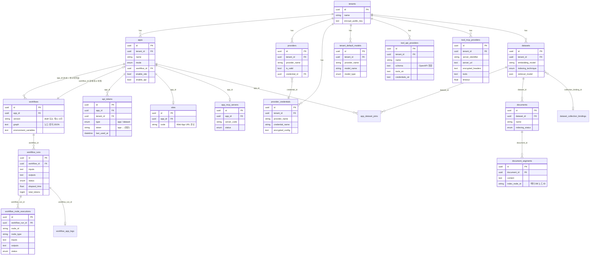

# Dify DB 스키마 (등록 관련)

> 상태: 초안 (2026-10-21)
> 출처: Dify 소스 `api/models/*.py` (SQLAlchemy ORM), **태그 1.17.1** (2026-09-10) 기준으로 직접 추출
> 관련: [04 플랫폼 구조 §3](04_dify_platform_structure.md)
>
> **이 문서는 이해를 돕기 위한 참고용이다.** 테이블과 컬럼은 버전마다 바뀌고(마이그레이션 220개 이상), 공식 계약이 아니다. 이 DB를 직접 조회하거나 수정하는 연동은 만들지 않는다 ([02 결정 로그](02_dify_agent_prerequisites.md)).

---

## 1. 등록 단계별로 저장되는 테이블

| 등록 단계 ([03](03_dify_agent_registration_guide.md)) | 테이블 | 저장 내용 |
|---|---|---|
| 워크스페이스 | `tenants` | 워크스페이스. `encrypt_public_key`(자격증명 암호화용 공개키) |
| ① 모델 공급자 | `providers` | 워크스페이스별 공급자 (`provider_name`, 유효 여부, 현재 사용 중인 자격증명 `credential_id`) |
| | `provider_credentials` | 공급자 자격증명 (`encrypted_config`: 엔드포인트, API Key 등) |
| | `provider_models`, `provider_model_credentials` | 직접 추가한 모델(OpenAI 호환 등)과 모델별 자격증명 |
| | `tenant_default_models` | System Model Settings (기본 LLM / Embedding / Rerank) |
| ② Custom Tool | `tool_api_providers` | OpenAPI 스키마 원문(`schema`), 파싱된 Tool 목록(`tools_str`), 인증 정보(`credentials_str`) |
| ② MCP | `tool_mcp_providers` | `server_url`, `server_identifier`, `encrypted_headers`, `encrypted_credentials`, `timeout`, `sse_read_timeout`, 가져온 Tool 목록(`tools`) |
| ③ Knowledge | `datasets` | Knowledge 설정: `embedding_model`, `embedding_model_provider`, `indexing_technique`, `retrieval_model`(JSON) |
| | `documents` | 업로드한 문서와 처리 상태 (`indexing_status`, 단계별 완료 시각, 토큰 수) |
| | `document_segments` | 청크 텍스트(`content`)와 벡터 DB 노드 ID(`index_node_id`) |
| | `dataset_collection_bindings` | 어떤 Embedding 모델이 어떤 **벡터 DB 컬렉션**에 대응하는지 |
| | `upload_files` | 원본 파일 메타데이터. 실제 파일은 파일 저장소의 `key` 경로에 있음 |
| ④ 앱 생성 | `apps` | 앱 기본 정보: `mode`(workflow / advanced-chat / agent-chat 등), `workflow_id`, `enable_site`, `enable_api` |
| ⑤ 노드 구성 | `workflows` | **워크플로 그래프 전체**(`graph`, JSON 텍스트), 환경변수, `version` |
| | `app_dataset_joins` | 앱 ↔ Knowledge 연결 |
| ⑦ 게시 | `workflows` | 게시할 때마다 행이 하나씩 추가됨 (아래 §3) |
| | `api_tokens` | 앱 API Key (`type`=app, `app_id`) 또는 Knowledge API Key (`type`=dataset) |
| | `sites` | Web App 설정 (`code` = 공개 URL 경로, 제목, 테마, 사용자 지정 도메인) |
| | `app_mcp_servers` | 앱을 MCP 서버로 공개할 때 (`server_code` = URL 경로, `status`) |
| | `tool_workflow_providers` | Workflow를 Tool로 게시할 때 |
| 실행 | `workflow_runs` | 실행 1건: `inputs`, `outputs`, `status`, `elapsed_time`, `total_tokens` |
| | `workflow_node_executions` | 노드별 실행 결과: `node_type`, `inputs`, `outputs`, `process_data`, `elapsed_time` |
| | `workflow_app_logs` | 앱 로그 목록 (`created_from`: service-api / web-app 등) |
| | `end_users` | API의 `user` 파라미터 값(`session_id`)과 Web App 사용자 |

> 2차(Chatflow / Agent)에서는 `conversations`, `messages`, `message_agent_thoughts` 테이블에 대화와 Agent의 Tool 호출 과정이 저장된다.

---

## 2. 관계도 (주요 컬럼만)



---

## 3. 알아두면 좋은 동작

### 3.1 초안과 게시 버전 (`workflows`)
- 편집기에서 수정하면 `version = 'draft'`인 행 **하나**가 계속 갱신된다.
- **Publish**를 누르면 그래프를 복사해서 `version = 게시 시각 문자열`인 **새 행**을 만들고, `apps.workflow_id`가 이 행을 가리키게 바뀐다.
- Service API는 `apps.workflow_id`가 가리키는 게시 버전을 실행한다. 그래서 편집 중인 초안은 운영 호출에 영향을 주지 않는다.
- 이전 게시 버전이 행으로 남아 있으므로 콘솔에서 버전 이력을 보고 되돌릴 수 있다.

### 3.2 자격증명 암호화
- LLM API Key, Tool 인증 정보, MCP 헤더 같은 비밀값은 **워크스페이스별 RSA 키 + AES**로 암호화해서 저장한다.
- 공개키는 `tenants.encrypt_public_key`에, **개인키는 파일 저장소의 `privkeys/<tenant_id>/private.pem`**에 있다 (`api/libs/rsa.py`).
- **백업할 때 PostgreSQL과 파일 저장소를 반드시 같이 백업한다.** 파일 저장소를 잃어버리면 DB가 남아 있어도 등록한 자격증명을 모두 다시 입력해야 한다.

### 3.3 앱 API Key는 평문으로 저장된다
- `api_tokens.token`에는 `app-` + 랜덤 24자가 **해시 없이** 저장되고, 조회 속도를 위해 Redis에도 캐시된다 (`controllers/console/apikey.py`, `controllers/service_api/wraps.py`).
- 따라서 **DB나 백업 파일에 접근할 수 있으면 API Key도 볼 수 있다.** DB 접근 권한과 백업 파일을 관리하고, 키는 주기적으로 교체한다.
- 앱마다 키를 여러 개 발급할 수 있다. 오케스트레이터용과 포탈용처럼 **호출하는 주체별로 키를 나누면** 키 하나를 폐기해도 다른 쪽에 영향이 없다.

### 3.4 실행 로그 용량
- `workflow_runs`와 `workflow_node_executions`의 `inputs`와 `outputs`에는 **전체 내용이 텍스트로 저장된다.** 로그 수백 줄을 Tool로 가져오면 그 내용이 실행할 때마다 DB에 쌓인다.
- 보관 기간과 정리 정책을 정하고, 로그 마스킹은 Code 노드에서 **LLM에 넘기기 전에** 한다 (마스킹 전 원문은 Tool 노드의 출력으로 저장되므로, 민감 정보가 많다면 자체 API 쪽에서 마스킹하는 것이 더 안전하다).

### 3.5 Dify DB에 없는 것
- **플러그인 설치 정보**는 `plugin_daemon`이 별도의 DB에 저장한다 (Docker Compose 기본 설정에서는 같은 PostgreSQL 서버의 별도 데이터베이스. 설치본의 `.env`에서 확인).
- **벡터**는 Vector DB에, **원본 파일과 개인키**는 파일 저장소에 있다.

### 3.6 Agent(v2) 설정은 JSON 한 덩어리로 저장된다

[06](06_dify_agent_configuration.md)의 Agent 설정(모델, 프롬프트, 스킬, 파일, 도구, 지식 검색, 환경 변수)은 항목별 테이블이 아니다. **`AgentSoulConfig` JSON 하나**로 저장된다.

| 테이블 | 저장 내용 |
|---|---|
| `agents` | Agent 기본 정보(이름, 역할, 아이콘), 현재 게시본 `active_config_snapshot_id` |
| `agent_config_drafts` | 편집 중인 초안. `config_snapshot` 컬럼(TEXT)에 설정 JSON 전체 |
| `agent_config_snapshots` | 게시할 때마다 `version`을 1씩 올린 **스냅샷 행을 새로 추가**. `config_snapshot`에 설정 JSON 전체 |
| `agent_config_revisions` | 이전 스냅샷 → 현재 스냅샷 변경 이력 |
| `workflow_agent_node_bindings` | 어느 Workflow의 어느 노드가 어떤 Agent(스냅샷)를 쓰는지 |
| `skills`, `skill_versions`, `skill_draft_files` | 워크스페이스 스킬 라이브러리 (스킬 자체의 원본과 버전) |
| `agent_skill_bindings`, `agent_skill_binding_snapshots` | Agent ↔ 라이브러리 스킬 연결 (초안 / 게시본별) |

**설정 JSON 안에서 각 항목을 가리키는 방식**

| 항목 | JSON 안의 참조 값 | 가리키는 대상 |
|---|---|---|
| 모델 | `plugin_id`, `model_provider`, `model` (**이름 문자열**). 자격 증명은 `credential_ref.id` (UUID) | 모델 공급자 설정 / 자격 증명 테이블 |
| 도구 | `provider_type` + `plugin_id`·`provider`(또는 `provider_id`) + `tool_name` (**문자열**). 자격 증명은 `credential_ref.id` (UUID) | 플러그인, 자체 API Tool, MCP, Workflow Tool |
| 지식 검색 | `datasets[].id` (UUID) | `datasets` |
| 파일 | `config_files[].file_id` (UUID) + `file_kind`(`upload_file` / `tool_file`) | `upload_files` / `tool_files` (실제 내용은 파일 저장소) |
| 업로드한 스킬 (EMBEDDED) | `config_skills[].file_id` (UUID, zip 파일) | `tool_files` |
| 라이브러리 스킬 | JSON이 아니라 **`agent_skill_bindings.skill_id` 컬럼** (UUID) | `skills` |
| 환경 변수 | `env.variables[]`(Plain), `env.secret_refs[]`(Secret)에 **이름과 값이 JSON 안에** | (참조 없음) |
| CLI 도구 | `tools.cli_tools[]`에 설치 명령, 도구별 환경 변수까지 JSON 안에 | (참조 없음) |
| 프롬프트 안 참조 | `[§tool:<provider>/<tool>§]`, `[§file:<이름>§]` 같은 **토큰 문자열** | 같은 JSON 안의 도구·파일 항목 |

**스킬 추가 방법별 저장 차이** (`services/agent/config_skill_normalize_service.py`, `core/tools/tool_file_manager.py`)

| | Upload package (EMBEDDED) | From skill library |
|---|---|---|
| 업로드 시 하는 일 | zip 검증·정규화 → **`tool_files`에 행 1개 추가** (이때 `id`를 UUID v4로 새로 만듦) → 파일 저장소 `tools/<tenant_id>/<랜덤 hex>.zip`에 저장 | 업로드 없음. 이미 있는 스킬을 연결 |
| Agent가 가리키는 값 | 설정 JSON의 `config_skills[].file_id` = `tool_files.id` | `agent_skill_bindings.skill_id` = `skills.id` (UUID v7) |
| 이름 | `SKILL.md`의 `name` (Agent 안에서 유일) | `skills.name` (워크스페이스 안에서 유일) |
| `skills` 테이블 등록 | **안 됨.** 라이브러리에 보이지 않는다 | 라이브러리에서 만들고 게시한 스킬 (`skill_versions`에 버전별 스냅샷) |
| 같은 zip을 다시 올리면 | 새 `tool_files` 행과 **새 UUID**가 생긴다 | 해당 없음 |
| 다른 Agent에서 재사용 | 각 Agent에 따로 올림 (UUID가 각각 다름) | 같은 `skill_id`를 연결 |

**정리**
- ID는 **UUID**를 쓴다. 순번(seq)은 쓰지 않는다. 새 테이블 일부는 시간순 정렬이 되는 UUID v7을 쓴다. 순번은 스냅샷 `version`, 리비전 `revision` 같은 버전 번호에만 쓴다.
- **DB 외래키(FK) 제약은 거의 없다.** 1.17.1 `models/` 전체에서 `ForeignKey`는 9곳(댓글, 대화 등)뿐이고, Agent·스킬 테이블에는 하나도 없다. 무결성은 애플리케이션 코드가 검사한다.
- 그래서 참조 대상이 지워져도 DB가 막지 않는다. 대신 JSON에 `is_missing` 표시가 남고, 화면에 "File not found", "Skill not found"로 나온다.
- 모델과 도구는 UUID가 아니라 **이름 문자열**로 참조한다. 그래서 DSL로 다른 Dify에 옮겨도 같은 이름의 플러그인과 모델이 설치되어 있으면 그대로 연결된다. 반대로 파일과 스킬 zip은 설치본마다 UUID가 달라서, 옮기면 `is_missing`이 되어 다시 올려야 한다.
- **환경 변수 값은 설정 JSON 안에 들어 있다.** 화면에는 Secret 값을 "암호화되어 저장된다"고 안내한다. 하지만 이번에 확인한 소스 범위(`models/`, `services/agent/`)에서는 암호화 코드를 찾지 못했다. 설치본 DB에서 `agent_config_snapshots.config_snapshot`의 `secret_refs` 값이 평문인지 직접 확인한다 ([02 H](02_dify_agent_prerequisites.md)).

---

## 4. 설치본에서 실제 스키마 확인하기

버전마다 다르므로, 정확한 스키마는 설치한 DB에서 직접 뽑는다. (읽기 전용으로만 사용)

```bash
# 테이블 목록
docker compose exec db_postgres psql -U postgres -d dify -c '\dt'

# 특정 테이블 구조
docker compose exec db_postgres psql -U postgres -d dify -c '\d workflows'

# 전체 스키마를 파일로 (데이터 제외)
docker compose exec db_postgres pg_dump -U postgres -d dify --schema-only > dify_schema_$(date +%Y%m%d).sql

# 현재 마이그레이션 버전
docker compose exec db_postgres psql -U postgres -d dify -c 'select * from alembic_version'
```

> 서비스 이름(`db_postgres`), 사용자, DB 이름은 설치본의 `docker-compose.yaml`과 `.env`에 맞게 바꾼다.

---

## 변경 이력

| 날짜 | 내용 |
|---|---|
| 2026-10-21 | 초안 작성. 1.17.1 소스 기준 등록 관련 테이블, ERD, 암호화·API Key 저장 방식 |
| 2026-10-21 | §3.6 Agent(v2) 설정 저장 방식 추가 (JSON 스냅샷, UUID 참조, FK 없음) |
