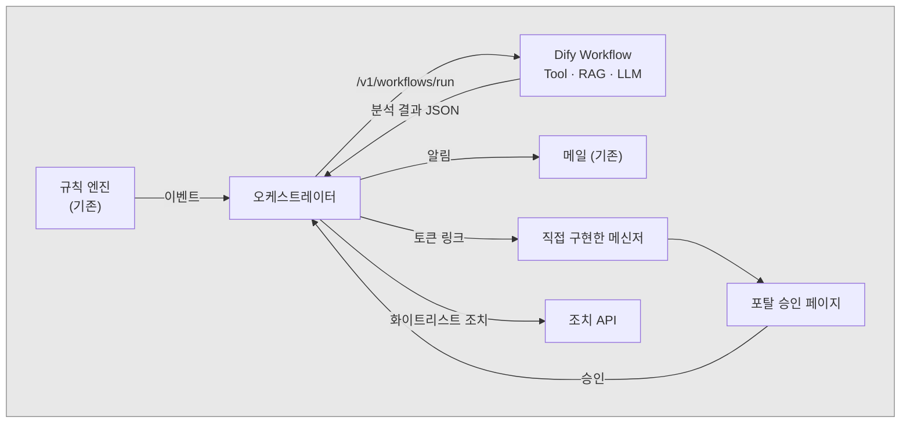

# AI Agent Portal PoC

임계치 기반 레거시 모니터링에 **AI 에이전트(Dify)** 를 붙여, 장애가 감지되면 알림을 보내는 데서 그치지 않고 1차 대응까지 하도록 만드는 PoC의 설계 문서입니다. 에이전트가 원인을 분석하고 조치를 제안하며, 사람이 승인하면 조치를 실행합니다.

현재는 **설계 문서 단계**입니다. 코드는 아직 없습니다.

## 문서

| 문서 | 내용 |
|---|---|
| [01 아키텍처](01_architecture.md) | 레거시 방식과 AI 에이전트 방식 비교, 목표 아키텍처, 처리 시퀀스, 데이터 계약, 승인 토큰 설계 |
| [02 사전 준비 체크리스트](02_dify_agent_prerequisites.md) | Dify 에이전트 등록 전 필수 입력값, 준비 항목, 열린 결정, 결정 로그 |
| [03 Dify 에이전트 등록 절차](03_dify_agent_registration_guide.md) | 모델, Tool, Knowledge 등록 → Workflow 구성 → 게시와 API 연결 → DSL 버전 관리 |
| [04 Dify 플랫폼 구조](04_dify_platform_structure.md) | 구성요소, 저장 위치, 등록·호출 흐름, 등록 API 표준 여부, 사용자 제공 형태, MCP 전송 방식 |
| [05 Dify DB 스키마](05_dify_db_schema.md) | 등록 관련 테이블 (Dify 1.17.1 소스 기준), ERD, 암호화와 API Key 저장 방식 |
| [초기 명세 (참고)](claude_code_prompt_specification.md) | 출발점이 된 초기 명세 |
| [참조](reference.md) | 작업 환경 설정 (VS Code에서 Mermaid 미리보기 설치 등) |

## 핵심 설계 원칙

- 정량 임계치 판정은 규칙 엔진(코드)이 한다. LLM은 이벤트가 발생했을 때만 호출한다.
- LLM은 미리 정해 둔 조치 ID(화이트리스트)만 출력한다. 자유 형식 명령은 실행하지 않는다.
- 조치는 사람이 승인한 뒤에만 실행한다. 승인 요청은 직접 구현한 메신저로 유효기간이 있는 토큰 링크를 보내고, 승인은 포탈의 승인 페이지(SSO)에서 한다.
- Dify는 Self-hosted로 운영한다. 연동은 공식 Service API와 `difyctl`만 사용한다.
- Dify가 장애일 때는 기존 메일 알림 경로가 대신 동작한다.

## 구성

> 문서 안의 호스트명(`*.internal`), 서비스명, 토큰 값은 모두 설명용 예시입니다.
